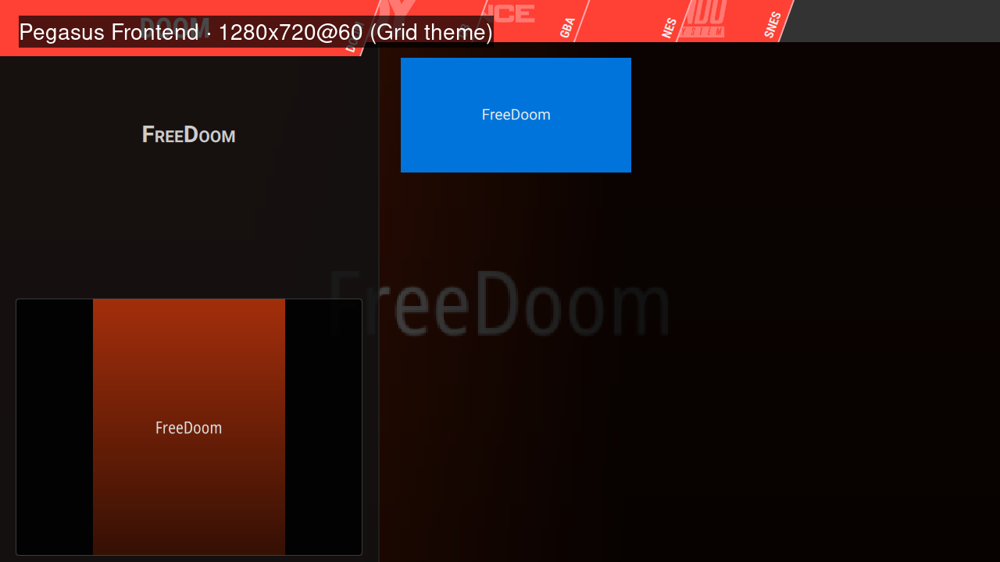
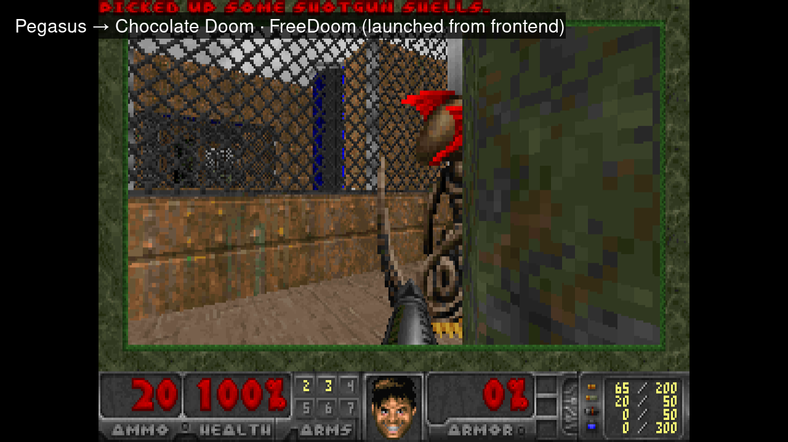

# mtgpu-pegasus

在 **Ubuntu 24.04 ARM64 + 摩尔线程 M1000（MTGPU）** 上运行的
[Pegasus Frontend](https://pegasus-frontend.org) 模拟器集合前端：一份可安装、可卸载、
带 720p@60 Game Mode 的整合方案。

状态：**可用**。已在 5 个平台上实测进入游戏，全部使用自由/开源 ROM：

| 平台 | 测试内容 | 模拟器 | 截图 |
|---|---|---|---|
| NES | Nova the Squirrel（开源同人游戏） | RetroArch · Nestopia core | [查看](images/nes-retroarch-nestopia.png) |
| SNES | Super Boss Gaiden（免费同人游戏） | RetroArch · Snes9x core | [查看](images/snes-retroarch-snes9x.png) |
| Game Boy | cpu_instrs（开源测试 ROM） | RetroArch · Gambatte core | [查看](images/gb-retroarch-gambatte.png) |
| GBA | ARMWrestler（开源测试 ROM） | RetroArch · mGBA core | [查看](images/gba-retroarch-mgba.png) |
| Doom | FreeDoom（开源 WAD） | Chocolate Doom | [查看](images/doom-chocolate-doom.png) |

前端界面（1280×720@60，Grid 主题）：



从前端点进游戏（Pegasus → Chocolate Doom）：



## 为什么不能直接用官方包

Pegasus 官方 release 没有通用 aarch64 桌面构建：`x11-static.zip` / `.deb` 是 x86_64，
`rpi4-static.zip` 是 **armhf（32 位 ARM，`ld-linux-armhf.so.3`）**，aarch64 桌面上跑不了。
本仓库在目标机上从源码构建（Qt 5.15 / CMake），二进制与脚本统一装到 **`/opt/pegasus`**。

## 安装

```sh
# 依赖（纯新增；不会升级/删除现有包）
sudo apt install git cmake g++ qtbase5-dev qtdeclarative5-dev qtmultimedia5-dev \
    libqt5svg5-dev qttools5-dev qtbase5-dev-tools qml-module-qtquick2 \
    qml-module-qtquick-controls2 qml-module-qtquick-layouts qml-module-qtquick-window2
sudo apt install retroarch libretro-nestopia libretro-snes9x libretro-gambatte \
    libretro-mgba libretro-genesisplusgx chocolate-doom

# 构建 Pegasus（Qt5；上游的 SortFilterProxyModel 依赖只支持 Qt5）
git clone --recursive https://github.com/mmatyas/pegasus-frontend
cd pegasus-frontend
cmake -B build -DCMAKE_BUILD_TYPE=Release -DCMAKE_DISABLE_FIND_PACKAGE_Qt6=ON
cmake --build build -j4

# 安装本仓库
cd /path/to/mtgpu-pegasus
sudo ./scripts/install.sh --binary /path/to/pegasus-frontend/build/src/app/pegasus-fe
```

安装内容：

- `/opt/pegasus/bin/pegasus-fe`、`game-mode-emulators.sh`、`uninstall.sh`、`share/config/`
- 应用菜单项 **“Game Mode - 模拟器”**（`~/.local/share/applications/game-mode-emulators.desktop`）
- `~/.config/pegasus-frontend/game_dirs.txt` 与各 ROM 目录的 `metadata.pegasus.txt`
- 所有 prefix 外的写入都记录在 `/opt/pegasus/INSTALL-MANIFEST.tsv`；apt 包只记录、不卸载

卸载：

```sh
sudo /opt/pegasus/uninstall.sh
```

## 使用

从应用菜单点 **“Game Mode - 模拟器”**，或：

```sh
/opt/pegasus/bin/game-mode-emulators.sh start   # 切 1280x720@60 → 开 Pegasus → 退出恢复
/opt/pegasus/bin/game-mode-emulators.sh status
/opt/pegasus/bin/game-mode-emulators.sh stop     # 手动恢复（2880x1800@120, scale 2）
```

- 画面**留在 KDE 桌面**（不切 VT、不启动额外 Xorg）；
- 进入时切到面板原生 **1280×720@59.97、scale 1.0**，退出时恢复 **2880×1800@119.93、scale 2**；
- QML 使用 software backend（M1000 的 EGL 在 KDE Wayland 下创建 dri2 screen 失败，
  否则界面会黑屏）。

## 目录结构

```
/opt/pegasus/
├── bin/pegasus-fe                 # 构建产物
├── bin/game-mode-emulators.sh     # 720p Game Mode + 启动/恢复
├── uninstall.sh
├── share/config/                  # 元数据模板（各平台 launch 命令）
└── INSTALL-MANIFEST.tsv
```

ROM 目录（默认 `~/文档/pegasus-roms`）：

```
pegasus-roms/
├── nes/  metadata.pegasus.txt  nova.nes
├── snes/ metadata.pegasus.txt  SuperBossGaiden.sfc
├── gb/   metadata.pegasus.txt  cpu_instrs.gb
├── gba/  metadata.pegasus.txt  armwrestler.gba
└── doom/ metadata.pegasus.txt  freedoom1.wad
```

每个目录里的 `metadata.pegasus.txt` 定义平台、扩展名、模拟器启动命令；
`media/<游戏名>/box2dfront.png` 是封面（Pegasus 的 `<game dir>/media/<title>/<type>.png` 约定）。

## 测试用 ROM（均为自由/开源，无版权问题）

- [Nova the Squirrel](https://github.com/NovaSquirrel/NovaTheSquirrel)（NES，开源）
- [Super Boss Gaiden](https://github.com/snesdev0815/SNES-SuperBossGaiden)（SNES，免费）
- [gb-test-roms](https://github.com/retrio/gb-test-roms)（GB，开源测试 ROM）
- [armwrestler-gba-fixed](https://github.com/destoer/armwrestler-gba-fixed)（GBA，开源测试 ROM）
- [FreeDoom](https://github.com/freedoom/freedoom)（WAD，开源）

## 已知限制

- 需要在 `/opt/kde6/bin/kscreen-doctor` 可用的 KDE 6 会话中运行（本机是 Plasma 6 Wayland）；
- 只验证了 5 个平台；Sega Genesis 等可加 ROM + 元数据接入（`libretro-genesisplusgx` 已装）；
- Ares/PS2/GameCube 等重型模拟器未接入；
- Grid 主题在 720p 下平台标签较挤（主题本身按更高分辨率设计），不影响使用；
- 不做模拟器 BIOS / 商业 ROM 的分发。

## 相关

- [Pegasus Frontend](https://pegasus-frontend.org)（[源码](https://github.com/mmatyas/pegasus-frontend)）
- [mtgpu-steam-fex](https://github.com/yeungtuzi/mtgpu-steam-fex)：本机 Steam + FEX + Proton 方案
- [reunion-lite](https://github.com/yeungtuzi/reunion-lite)：红警2 启动器

## License

MIT（本仓库脚本与文档）。Pegasus 为 MIT；RetroArch 为 GPLv3。
